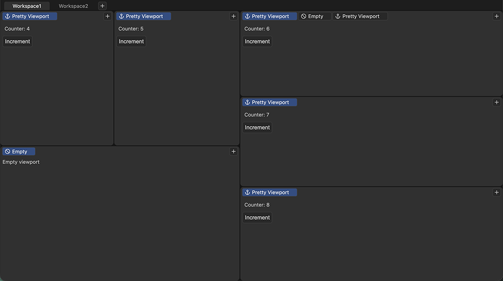

# Toolmate

[](https://badge.fury.io/js/@toolmate%2Fcore)

Toolmate is a framework for building editors. It gives your project workspaces, areas and tabs. Everything else comes from plugins, written by you or by the community.

- A workspace holds one or more areas placed side by side.
- An area holds one or more tabs.
- To resize areas, drag the border between them.
- To split an area, drag a tab to one of its sides.
- To move a tab, drag it onto the tab bar of another area. To reorder tabs, drag a tab within its own tab bar.



## Setup

Create a new npm project, e.g. `my-game-editor`. I suggest using Vite: `npm create vite`.

Install Toolmate's core:

```sh
npm i @toolmate/core
```

Add this to the main script of your project:

```ts
import '@toolmate/core/style'
import { render } from '@toolmate/core'

render()
```

Run the project:

```sh
npm run dev # Works only if you used `npm create vite`. Otherwise use your own command to start the dev server.
```

## More info is coming soon

## License

Toolmate is licensed under [GNU AGPLv3](./LICENSE).
